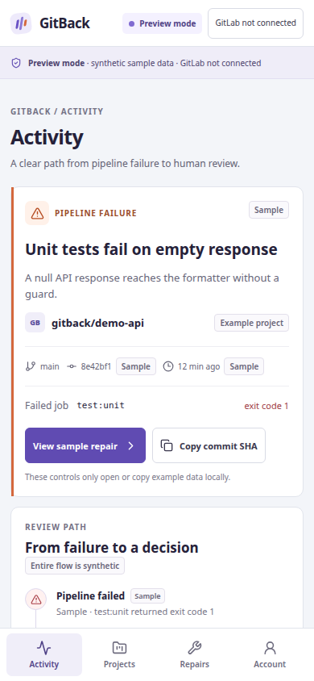

# ISyCoFeedback

Bounded execution, repair, review and independently checkable evidence.

Version **2.0.0a1** merges three owned codebases under one Python package. The
command workflow combines reviewed project commands, explicit patch proposals,
durable attempts, rollback, sealed receipts and a hash-chained ledger. Generic
document review and operational lifecycle components remain available as library APIs.

## GitBack mobile web preview

The mobile-first PWA prototype lives in [`web/`](web/README.md). It requires
Node.js **20.19+** (or **22.12+**) and npm:

```bash
cd web
npm ci
npm run dev
```

This is a synthetic-only interface: GitLab and Duo are not connected, no real
tests run, and review controls do not send remote changes.



```bash
python -m pip install -e '.[dev]'
isycofeedback demo
isycofeedback document-demo
python -m pytest -q
```

Python 3.11+ is required. The demo runs actual local verification against a
synthetic fixture using a fixed patch proposal. It demonstrates PASS, DENIED,
REPAIR_EXHAUSTED and tamper detection. It does not call an AI service.

Configure `.isycofeedback.yml` using `isycofeedback init`, review its commands,
and use `test`, `retry` or `repair --patch-file proposal.json --allow src/file.py`.
Use `--run-id` to retain a budget across invocations. A budget permits at most
three verifications, including the initial failure. Without that option each
invocation creates a new run; this is not a global per-MR budget.

`history` reads durable state. After stopping interrupted workers, explicitly use
`recover` to mark incomplete work UNKNOWN; no external action is silently replayed.
Durable patch backups are restored only when the current contents still match
the proposed patch. Later user changes are preserved and unresolved backups remain
retryable. Proposals/originals containing configured secret values are denied before
backup persistence. Unknown secrets cannot be detected automatically.
`audit` verifies receipts and ledger together. Retain the printed ledger head
independently and use `audit --expected-head HASH` to detect truncation relative
to that anchor. Hashes do not authenticate human identity or the executing host.

Commands use the host shell. Run untrusted projects in an external sandbox.
Patch allowlists constrain the patch applier, not arbitrary authorized commands
or trusted Python callbacks. Linux/Python 3.12 was exercised offline; Windows
process-tree cleanup and live external integrations remain unverified.

The document API preserves unknown confidence and binds declared review records
to extraction hashes; it does not authenticate a reviewer. The operational API
separates provider acceptance from explicit acknowledgement and preserves crash
uncertainty. No customer data, vendor SDK, external delivery channel, cloud sync
or previous GUI bundle is included.

The live GitLab Duo flow and public deployment are pending. Prior code retains
its original history and must be disclosed separately from new hackathon work.
See the [Spanish usage guide](README.md), [provenance](docs/PROVENANCE.md) and
[MIT license](LICENSE).


## 2026-10-31 — newly versioned files

Commit `36f4ac4` brings in 69 files that were previously untracked:

- `src/isycofeedback/documents/` and `src/isycofeedback/operations/` (including
  `persistence/` with sqlite, memory and repository), plus `audit.py`, `demo.py`,
  `workflow.py`, `workflow_store.py` and `__main__.py`.
- `tests/` — 12 test modules (documents, operations, unified CLI, merge boundaries).
- `docs/` — `PROVENANCE.md`, `VERIFICATION.md`, `GITBACK_ROADMAP.md`, `GITLAB_CI.md`,
  `MIGRATION_MANIFEST.json` and the `verification-*.log` records.
- `web/` — the GitBack Vite app (`index.html`, `src/main.tsx`, `public/`, config).
- CI: `.github/workflows/ci.yml` and `.gitlab-ci.yml`.
