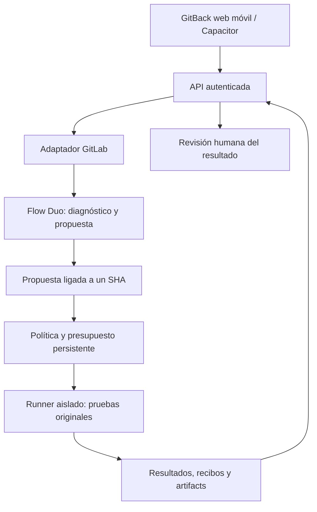

# GitBack — roadmap de producto y entrega

Fecha: 22 de octubre de 2026. Horarios: Ciudad de México.
Estado: acceso Contributor y proyecto público Showcase provisionados. El trigger GitLab-managed `Fix CI/CD Pipeline` está creado para `Pipeline events (Failed)`, pero todavía no se ha demostrado una ejecución Duo real. Showcase sigue sin CI ni el producto GitBack publicado; este roadmap no declara terminada ninguna integración ni demo.

## 1. Producto y objetivo

**GitBack permite supervisar y verificar reparaciones de software desde el teléfono, con GitLab Duo como agente y evidencia de cada resultado.**

Usuario inicial: una persona que mantiene proyectos en GitLab, deja una pipeline ejecutándose y necesita investigar un fallo, solicitar una reparación y revisar su resultado sin volver al escritorio.

Promesa del MVP: una reparación acotada de un fallo real, en un proyecto de demostración, visible desde una aplicación web móvil pública. El agente propone; la política limita; un verificador ejecuta las pruebas; la persona revisa el resultado final.

GitBack será la marca visible. ISyCo conserva la atribución de autor donde corresponda. El cambio de marca no elimina procedencia, licencias ni historial. Disponibilidad del nombre, dominio e identificadores todavía sin comprobar.

## 2. Punto de partida comprobado

| Pieza | Evidencia disponible | Trabajo pendiente |
|---|---|---|
| Núcleo Feedback 2.0 alpha | Informe local: 179 pruebas en Linux/Python 3.12; demo y wheel instalado verificados | Integrarlo con GitLab y comprobarlo desplegado |
| PWA GitBack | Prototipo mobile-first en `web/` con Activity, Projects, Repairs y Account; los fixtures y las decisiones de revisión están rotulados como sintéticos y permanecen locales | Acordar contratos, integrar GitLab/Duo y demostrar un fallo y una verificación reales; la PWA no se conecta todavía |
| Reparación | Propuestas explícitas, alcance permitido, verificación original y rollback | Propuesta procedente de una sesión Duo real |
| Persistencia | SQLite, intentos por run ID y recuperación de interrupciones | Correlación con proyecto/MR/SHA y concurrencia del servicio |
| Evidencia | Recibos, ledger y auditoría contra ancla externa | Publicación, retención y asociación a ejecuciones remotas |
| Documentos y operaciones | Bibliotecas genéricas importadas y verificadas | Usar sólo lo necesario para los reportes del MVP |
| MovilClaw | Código y documentación de PWA, orquestación y sandboxes | Evaluar piezas aisladas; integración actual orientada a GitHub |
| iSyCode Móvil | Código de sesiones, actividad y aprobaciones | Adaptar contratos y UX; SwiftUI no se copia directamente a la web |
| ISyMotron móvil | Proyecto TypeScript/Vite/Capacitor, tareas, permisos y recibos | Extraer patrones útiles y verificar builds propios de GitBack |
| GitLab / hackathon | Aprobación Contributor recibida; workspace `gitlab-ai-hackathon/transcend-october-2026/43036043` y proyecto público `showcase` creados el 22 de octubre; proyecto ID `87947959`; trigger GitLab-managed creado para `Pipeline events (Failed)` | Publicar el MVP, comprobar Duo Agent Platform, rol efectivo, runner y ejecución real; Devpost requiere reautenticación para verificar registro y entrega |
| Showcase | Rama `main`, un commit inicial con README de plantilla y sin `.gitlab-ci.yml`; trigger `Fix CI/CD Pipeline` configurado para pipelines fallidas, aún sin ejecución verificable. El CI y la guía para un fallo opt-in están preparados localmente en `.gitlab-ci.yml` y `docs/GITLAB_CI.md`, pero todavía no se publicaron en Showcase | Publicar el producto y CI, ejecutar el fallo controlado y comprobar que el flow genera una salida revisable |

Las pruebas existentes describen el núcleo, no certifican la futura app. Los tres proyectos móviles se inspeccionaron; no se ejecutaron de nuevo sus suites ni builds en esta revisión.

Referencias locales: [verificación](VERIFICATION.md), [resultados](verification-results.json), [procedencia](PROVENANCE.md).

## 3. Restricciones del concurso

Base de trabajo: **Path B**, por reutilizar código existente. Las reglas exigen Duo Agent Platform, base MIT identificable, repositorio público GitLab con instrucciones e historial CI/CD y automatización/despliegue nuevos durante el periodo. Path B requiere despliegue público disponible durante la evaluación. Registro Devpost y onboarding Contributor son pasos separados. Materiales en inglés o con traducción y video público de menos de tres minutos. Cierre: **27 de octubre de 2026, 07:00 CDMX**; objetivo interno: **26 de octubre, 18:00**. [Reglas oficiales](https://gitlab-transcend.devpost.com/rules).

El tema es automatizar trabajo posterior al código: revisión, pruebas, seguridad, entrega u operación. Nuestra historia cubrirá diagnóstico, reparación, verificación y revisión del resultado. La amplitud adicional sólo cuenta si funciona. [Presentación del reto](https://gitlab-transcend.devpost.com/).

La disponibilidad de Duo, runners, créditos y permisos debe demostrarse en el proyecto efectivo. La documentación de un servicio no prueba su habilitación en nuestra cuenta.

## 4. Recorrido principal

1. Entrar a GitBack y abrir el proyecto de demostración.
2. Consultar una pipeline fallida con enlace al job y al commit exactos.
3. Solicitar una reparación de ese fallo.
4. Ver el diagnóstico y el avance del agente, con hora de última actualización.
5. Examinar propuesta y resultados de las pruebas originales.
6. Abrir el diff y revisar el resultado final.
7. Registrar aceptación o petición de cambios; consultar su efecto real en GitLab.

La aceptación de una reparación en GitBack y la aprobación nativa de un MR son operaciones distintas. La interfaz deberá nombrarlas según lo que efectivamente hizo y mostrar la respuesta del servidor. El MVP no fusionará automáticamente.

Casos secundarios necesarios: reparación rechazada por alcance, intentos agotados, sesión expirada, desconexión y resultado desconocido tras interrupción.

## 5. Arquitectura propuesta

### Responsabilidades

- **App:** consultar, solicitar, explicar estados y recoger decisiones humanas. Cerrar la app no detiene los workers.
- **API:** autenticar, comprobar autorización por proyecto, deduplicar solicitudes y presentar eventos.
- **Adaptador GitLab:** consultar pipelines/jobs/MRs, publicar resultados y ejecutar únicamente acciones permitidas.
- **Duo:** investigar el fallo y preparar una propuesta estructurada; su texto no es un resultado de pruebas.
- **Verificador:** aplicar las restricciones y ejecutar las pruebas originales en un entorno separado del agente.
- **Almacén:** conservar identidades, presupuestos, eventos y evidencia; artifacts complementan esa persistencia.

Stack candidato: núcleo Python existente; API Python con ASGI; frontend TypeScript/Vite; Capacitor para paquetes móviles. Framework de UI y librería API se decidirán en un diseño técnico corto antes de implementar esos subsistemas.

La separación debe ser efectiva: no basta con pedirle al agente que no toque tests. El entorno verificador obtiene pruebas/política de una referencia confiable, y el agente no tiene credenciales ni permisos para cambiarlas. El allowlist de parches existente no es un sandbox de sistema operativo.

### Integración inicial de Duo

Usar inicialmente el flow foundational administrado por GitLab `Fix CI/CD Pipeline`. En Showcase quedó configurado un trigger `Pipeline events (Failed)`; GitLab rechazó `Mention` para este flow porque no admite ese tipo de evento. Falta añadir CI y validar una ejecución real con runner, sesión Duo y una propuesta o merge request revisable. No prometer un endpoint propio de ejecución hasta verificar el mecanismo admitido.

GitLab documenta [custom flows](https://docs.gitlab.com/user/duo_agent_platform/flows/custom/), [triggers](https://docs.gitlab.com/user/duo_agent_platform/triggers/) y [ejecución de flows](https://docs.gitlab.com/user/duo_agent_platform/flows/execution/). La configuración YAML se ajustará al esquema vigente; no reutilizar ejemplos incompatibles por intuición.

## 6. Contratos que debemos cerrar antes del código de integración

| Concepto | Decisión propuesta | Comprobación |
|---|---|---|
| Identidad del trabajo | Instancia + project ID + MR IID + SHA base + job fallido + versión de política | Dos solicitudes del mismo trabajo reutilizan presupuesto |
| Nueva revisión | Un SHA nuevo requiere un trabajo explícitamente nuevo | Una aprobación vieja no autoriza el nuevo diff |
| Presupuesto | Máximo tres verificaciones por trabajo, incluida la inicial | Reinicio o doble toque no lo reinicia |
| Propuesta | Archivos existentes permitidos, contenido previo exacto y contenido nuevo | Rechazar pruebas, controles CI, symlinks y escapes |
| Aprobación | Usuario + trabajo + SHA del resultado + versión de decisión | Rechazar solicitudes vencidas, repetidas o desactualizadas |
| Resultado | Exit code observado y referencia a las pruebas ejecutadas | El resumen del modelo no transforma FAIL en PASS |
| Evidencia | IDs de ejecución, timestamps UTC, hashes, resultado y procedencia | Cada tarjeta abre su evidencia real |
| Eventos | ID monotónico por trabajo y reconciliación con estado persistido | Reconexión sin duplicar acciones |

El núcleo actual aplica presupuesto por run ID; la integración debe añadir la deduplicación por identidad de trabajo. Crear otro run ID no puede ser una forma de repetir ilimitadamente la misma solicitud.

Estados propuestos del servicio: QUEUED, ANALYZING, PROPOSING, VERIFYING, AWAITING_REVIEW, ACCEPTED, CHANGES_REQUESTED, FAILED, DENIED, EXHAUSTED, UNKNOWN y CANCEL_REQUESTED. Son estados nuevos de orquestación; habrá un mapeo explícito a los resultados existentes del núcleo. Cancelar una petición no demuestra que se canceló el proceso externo.

## 7. Producto móvil y diseño Pajamas

Referencia: [Pajamas](https://design.gitlab.com/), su documentación y componentes. Reutilización de archivos/código condicionada a revisar la licencia de cada paquete y conservar avisos. GitBack tendrá logo, nombre e identificación independiente.

### Pantallas del MVP

| Pantalla | Pregunta que resuelve | Contenido imprescindible |
|---|---|---|
| Acceso | ¿Qué cuenta y proyecto estoy usando? | Identidad, conexión y salida |
| Actividad | ¿Qué necesita mi atención? | Fallos, reparaciones pendientes y estado actualizado |
| Proyecto | ¿Qué falló aquí? | Últimas pipelines, commit y enlace GitLab |
| Reparación | ¿Qué está haciendo y por qué? | Timeline, presupuesto y resultado |
| Revisión | ¿Qué cambió y qué se verificó? | Diff, pruebas, SHA y decisión |
| Evidencia | ¿De dónde sale este resultado? | Logs redactados, recibo y enlaces |

Navegación inferior: Actividad, Proyectos, Reparaciones y Cuenta. Evidencia y revisión se abren dentro de una reparación. Una sola acción principal por pantalla.

Superficies neutras, violeta como acción, naranja como acento y colores semánticos acompañados de texto/icono. Tokens propios para colores, espaciado, tipografía y tamaños táctiles; no copiar una pantalla de escritorio y reducirla.

Criterios: navegación por teclado; foco visible; contraste AA medido; controles táctiles de al menos 44 CSS px; pruebas a 360 y 390 px; texto ampliado; estados vacíos/error/carga; diffs legibles sin desbordar toda la página; modo claro y oscuro si el segundo no retrasa el recorrido principal. Sincronización visible y decisiones bloqueadas cuando el estado no sea actual.

### Dos modos públicos claramente separados

- **Demo de lectura:** pública, sin credenciales del visitante, con datos sintéticos y evidencia de ejecuciones reales identificadas. No permite lanzar comandos arbitrarios.
- **Proyecto conectado:** requiere autenticación y autorización; las acciones modifican el proyecto de prueba de acuerdo con sus permisos.

Un modo de lectura por sí solo no demuestra la automatización. La entrega necesita una ejecución Duo real y reproducible, además de una app pública funcional.

## 8. Reutilización concreta

| Origen | Reutilizar/evaluar | Dejar fuera del MVP |
|---|---|---|
| Feedback | Workflow, SQLite, recibos, audit y regresiones | Renombrado masivo de imports antes del E2E |
| Trustworthy | Estructura de evidencia y revisión genérica | Producto de facturas o gestión documental independiente |
| OTP | Estados durables y recuperación | Integraciones de logística, clientes o comunicaciones antiguas |
| ISyMotron | Shell Capacitor, patrones de tareas/permisos/recibos y pruebas de UI útiles | Runtime GUS, modelos y protocolo LAN como dependencia obligatoria |
| iSyCode Móvil | Patrones de timeline, decisiones vigentes y reconexión | Copiar el cliente Swift como frontend multiplataforma |
| MovilClaw | Patrones PWA y aislamiento que podamos verificar | Cambiar OAuth GitHub por GitLab sustituyendo URLs sin rediseño |

No migrar los tres móviles enteros. Cada pieza admitida tendrá origen, licencia, dependencias, adaptación y prueba de aceptación registrados.

## 9. Backlog priorizado

### P0 — entrega funcional

- [x] Confirmar aprobación Contributor y provisionamiento del proyecto Showcase.
- [x] Crear en Showcase el trigger `Fix CI/CD Pipeline` para `Pipeline events (Failed)`; la ejecución real sigue pendiente.
- [ ] Conservar baseline, historial y MIT; preparar GitLab público.
- [ ] Ejecutar una sesión Duo real y conservar su identificador.
- [ ] Reparar un fallo real con propuesta Duo y verificación independiente.
- [ ] Relacionar MR/SHA/job con presupuesto durable y deduplicación.
- [ ] Publicar reporte y artifacts útiles en GitLab.
- [ ] Exponer API autenticada y app web móvil desplegada por HTTPS.
- [ ] Revisar diff y registrar decisión final desde un teléfono.
- [ ] Demostrar PASS y un rechazo real, sin simular éxito.
- [ ] Preparar video, instrucciones reproducibles y entrega Devpost.

### P1 — si P0 funciona completo

- [ ] Instalar PWA con manifest e iconos propios.
- [ ] Compilar APK de GitBack y probar el recorrido en Android físico.
- [ ] Empaquetar iOS y probarlo si contamos con entorno de firma/dispositivo.
- [ ] Añadir modo oscuro completo y ajustes de accesibilidad adicionales.
- [ ] Medir latencia/coste por ejecución y mostrar presupuesto consumido.
- [ ] Facilitar una segunda clase de fallo sólo si no rompe la historia principal.

### P2 — después del concurso

- [ ] Notificaciones push con backend y permisos explícitos.
- [ ] Múltiples proyectos y cuentas; instancias Self-Managed.
- [ ] Políticas de equipos y aprobaciones de despliegue.
- [ ] Flujos para seguridad, dependencias y releases.
- [ ] Herramientas MCP si aportan una interfaz útil y verificable.
- [ ] Distribución estable Android/iOS y operación multiusuario.

## 10. Calendario contra reloj

Estimaciones de trabajo concentrado, no garantía. Revisar al terminar cada hito. No esperar al último día para comprobar el acceso Duo.

| Fecha | Entregable | Condición de salida | Esfuerzo orientativo |
|---|---|---|---|
| Jue 22 | Recuperar sesión y probar Duo en Showcase | Sesión real identificada; permiso, runner y un fallo de prueba conocidos | 2–4 h |
| Vie 23 | Reparación completa en GitLab sin app | Fallo → Duo → propuesta → pruebas → evidencia real | 5–8 h |
| Sáb 24 | API y primera web móvil | Un trabajo real visible desde teléfono; doble toque deduplicado | 5–8 h |
| Dom 25 | Revisión móvil y despliegue público | Diff/SHA, decisión vigente y retorno del servidor verificables | 5–8 h |
| Lun 26 | Casos negativos, video y entrega | Reinicio, permisos, rechazo y navegación real probados | 4–6 h |
| Mar 27, antes de 07:00 | Margen final | Verificar recepción y disponibilidad; sólo correcciones críticas | Reserva |

Objetivo orientativo total: 25–40 horas concentradas para el recorrido P0, sujeto sobre todo al acceso Duo y al despliegue. Android/iOS empaquetados no están incluidos como condición del P0.

### Reglas de recorte

- Sin E2E Duo al acabar el 22: congelar trabajo de APK/IPA, animaciones, temas y notificaciones; concentrarse en acceso/integración.
- Sin web conectada al acabar el 23: limitar a un proyecto y una clase de fallo, con actualización por polling.
- Sin revisión móvil fiable el 24: abrir el diff/MR en GitLab para la decisión nativa; declarar que el recorrido termina fuera de GitBack. Baja el alcance, no se anuncia aprobación propia.
- El 25 congelar funcionalidades; el 26 sólo reparar defectos de entrega.
- Si Duo sigue inaccesible, conservar el producto funcional y documentar el bloqueo; una propuesta fija no reemplaza el requisito de Duo.

## 11. Hitos verificables y dependencias

| Hito | Depende de | Evidencia para marcarlo terminado |
|---|---|---|
| G0 Acceso | Onboarding, sesión autenticada y permisos | Proyecto provisionado **y** una sesión Duo efectiva identificada; provisionamiento ya confirmado, sesión Duo aún pendiente |
| G1 Automatización | G0 | Pipeline fallida y reparación real, IDs y logs |
| G2 Contrato durable | G1 | Duplicado/reinicio no regalan intentos; SHA nuevo invalida revisión vieja |
| G3 Servicio y móvil | G2 | Flujo autenticado observado desde teléfono |
| G4 Revisión | G3 | Decisión ligada al diff actual y efecto real confirmado |
| G5 Entrega | G4 | App pública, reproducción, video y enlaces accesibles |
| G6 Paquetes móviles | G5 o P0 estable | APK/IPA instalados y recorrido probado en su plataforma |

G0 → G1 → G2 es el camino crítico. Diseño de tokens y borrador de pantallas pueden avanzar mientras se resuelve el acceso, pero no sustituyen esos hitos.

## 12. Seguridad y confiabilidad que sí pertenecen al producto

- Sesiones de usuario y permisos por proyecto, comprobados en servidor en cada acción.
- Para la web, preferir sesión HttpOnly y tokens GitLab en servidor; para paquetes nativos, resolver OAuth/PKCE y almacenamiento del sistema en su diseño específico. No distribuir un client secret dentro de la app.
- Peticiones mutantes protegidas frente a CSRF, doble envío y estados obsoletos.
- Webhooks autenticados y deduplicados. El servicio no clona una URL arbitraria recibida del cliente.
- Proyecto de demostración sintético, sin datos reales de cliente; logs y artifacts redactados antes de publicar.
- Verificador efímero aislado, con límites de tiempo/recursos y política de red; las credenciales de publicación permanecen fuera del agente y del código candidato.
- Tests/política/base confiable fijados fuera del alcance de reparación; no aceptar un PASS logrado borrando la prueba fallida.
- UNKNOWN ante interrupción incierta; recuperación explícita y sin repetición automática del efecto externo.
- Hashes con ancla externa para integridad; sin presentarlos como firma de identidad o garantía absoluta.
- Retención de artifacts y almacenamiento que cubra la evaluación; no depender de disco efímero para presupuestos.

## 13. Plan de verificación

| Nivel | Casos que aportan valor |
|---|---|
| Núcleo | Suite existente y regresiones que afecte la integración |
| Contratos | Proyecto ajeno, SHA obsoleto, doble solicitud, payload inválido y scopes insuficientes |
| Integración GitLab | Rate limit, credencial revocada, job ausente, evento duplicado y respuesta tardía |
| Duo real | Sesión trazable, propuesta recibida y asociación al fallo correcto |
| Verificador | Reparación válida, modificación fuera de alcance y fallo persistente |
| Persistencia | Reinicio con trabajo en curso, presupuesto conservado y estado UNKNOWN |
| Web móvil | Login, listado, reparación, diff, decisión, reconexión y logout |
| Plataforma | Navegador físico; APK/IPA sólo se anuncian probados si se instalaron |
| Publicación | Enlaces de lectura accesibles sin sesión del autor; acciones protegidas |

Fixtures y mocks se etiquetan como tales. Conservar al menos un recorrido real completo y un caso negativo real. No multiplicar pruebas de cosmética que sólo repitan la implementación.

## 14. Métricas y definición de terminado

Objetivos iniciales de aceptación, no estadísticas ya medidas:

- Un fallo reproducible reparado por una propuesta Duo real y validado por las pruebas originales.
- Tres repeticiones del escenario completo con resultados explicables; registrar variación y fallos, no ocultarlos.
- Cero solicitudes duplicadas ejecutadas por doble toque en las pruebas previstas.
- Cero decisiones obsoletas aceptadas en las pruebas previstas.
- Una reparación fuera de alcance rechazada con explicación visible.
- Navegación completa en un teléfono sin necesitar una terminal del usuario.
- Cada resultado importante enlazado a commit, ejecución y evidencia.
- Tiempos de diagnóstico, verificación y revisión registrados por separado; informar mediciones reales antes de fijar un SLA.

La entrega queda terminada cuando otro evaluador puede entender qué ocurrió, abrir la app, seguir la evidencia y reproducir el recorrido con las instrucciones y recursos indicados.

## 15. Demo y materiales

Guion objetivo de 2:40:

| Tiempo | Mostrar |
|---|---|
| 00:00–00:20 | Problema: pipeline fallida y revisión lejos del escritorio |
| 00:20–00:45 | GitBack en teléfono y solicitud de reparación |
| 00:45–01:25 | Sesión Duo real, propuesta y pruebas; acelerar espera con indicación visible |
| 01:25–02:00 | Diff, resultado y decisión final |
| 02:00–02:25 | Rechazo por alcance y evidencia |
| 02:25–02:40 | Arquitectura breve y enlaces para probar/reproducir |

Paquete: README en inglés, instrucciones del flow y despliegue, variables por nombre sin valores, diagrama, procedencia y baseline, limitaciones, video y enlaces. Describir exactamente el nivel de autonomía demostrado; proponer Supervised sólo si los intentos transcurren sin aprobación individual y la revisión humana es al final.

## 16. Ruta de producto después del concurso

| Horizonte orientativo | Objetivo | Validación antes de ampliar |
|---|---|---|
| Semanas 1–2 posteriores | Beta pequeña: onboarding, errores, observabilidad y backups | 3–5 personas completan el recorrido sin ayuda directa |
| Semanas 3–4 | Android sólido, iOS según acceso, notificaciones y reconexión | Instalación física, logout/revocación y entrega de avisos probadas |
| Mes 2 | Equipos, varios proyectos, políticas y cuotas | Aislamiento entre usuarios/proyectos y recuperación ensayados |
| Mes 3 | Segundo flujo útil: seguridad o releases | Demostrar mejora medible sin degradar reparación |
| Después | Self-Managed, distribución y posibles integraciones MCP | Demanda real y coste de mantenimiento sostenible |

El calendario posterior es dirección de producto, no compromiso de lanzamiento. Elegir nuevas funciones por usos observados y métricas.

## 17. Migración de marca y organización del trabajo

1. Usar GitBack en el diseño, la app nueva y los materiales de entrega.
2. Mantener inicialmente `isycofeedback` como paquete interno para no mezclar cambios de imports con integración.
3. Elegir nombre público de repo e identificadores móviles después de comprobar disponibilidad.
4. Añadir nueva identidad preservando historia, MIT y procedencia; no borrar los originales.
5. Separar luego especificaciones ejecutables: integración Duo/verificador, API/autenticación, interfaz móvil y empaquetado.

Este roadmap no ordena renombrar carpetas existentes, publicar repositorios o desplegar ahora. Es el documento de alcance solicitado; los hitos pendientes son trabajo futuro.

## 18. Siguiente paso concreto

Cerrar **G0 y G1**: demostrar una sesión Duo con un fallo sintético y una verificación real. Ese resultado permitirá fijar el contrato técnico del flow y del adaptador; después se escribe el plan de implementación del servicio y de la app sobre interfaces comprobadas.

## Fuentes de referencia

- [Reglas oficiales](https://gitlab-transcend.devpost.com/rules).
- [Tema y requisitos generales](https://gitlab-transcend.devpost.com/).
- [Pajamas](https://design.gitlab.com/).
- [Custom flows](https://docs.gitlab.com/user/duo_agent_platform/flows/custom/).
- [Triggers](https://docs.gitlab.com/user/duo_agent_platform/triggers/).
- [Ejecución de flows](https://docs.gitlab.com/user/duo_agent_platform/flows/execution/).
- [Artifacts](https://docs.gitlab.com/ci/jobs/job_artifacts/).
- [Mobile DevOps](https://docs.gitlab.com/ci/mobile_devops/).

Fuentes y estado local revisados el 21 de octubre de 2026. Si cambian reglas, disponibilidad o resultados, actualizar el roadmap antes de usarlo como base de entrega.
