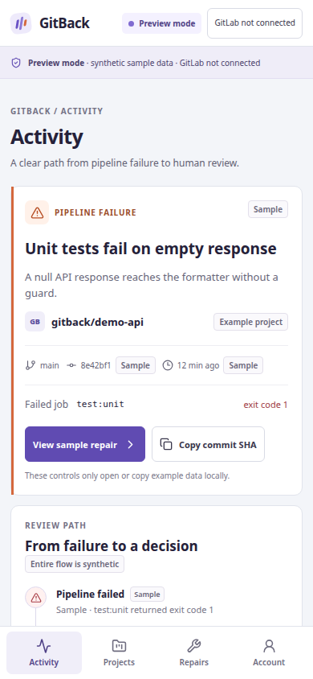

# GitBack web preview

This is a mobile-first, synthetic-only PWA prototype for the GitBack hackathon project. It illustrates the path from a failed pipeline to a proposed repair and human review.

All repositories, pipelines, logs, diffs, and test results shown in the interface are fixtures. GitLab is disconnected: this preview has no OAuth, GitLab or Duo API calls, real test execution, or remote actions. Accepting a sample or requesting changes only updates in-memory UI state and resets on reload.

## Run locally

Requires Node.js 20.19+ (or 22.12+) and npm, matching the Vite toolchain.

```sh
npm install
npm run dev
```

Open the local URL printed by Vite, usually `http://localhost:5173`.

## Build

```sh
npm run build
npm run preview
```

The build runs TypeScript checks before Vite. The service worker is registered only in production and caches same-origin app assets; the app does not connect to external services.

## Layout

- `src/main.tsx` — navigation, Activity, Projects, Repairs, Account, and local review interactions.
- `src/fixtures.ts` — clearly synthetic records for example repositories, repair proposals, logs, and test results.
- `src/styles.css` — visual tokens, responsive layouts, focus states, and reduced-motion support.
- `public/` — PWA manifest, original GitBack mark, and same-origin service worker.

The visual language takes inspiration from public Pajamas principles for clear hierarchy and status communication without copying GitLab screens or using its logo.

## Mobile preview


